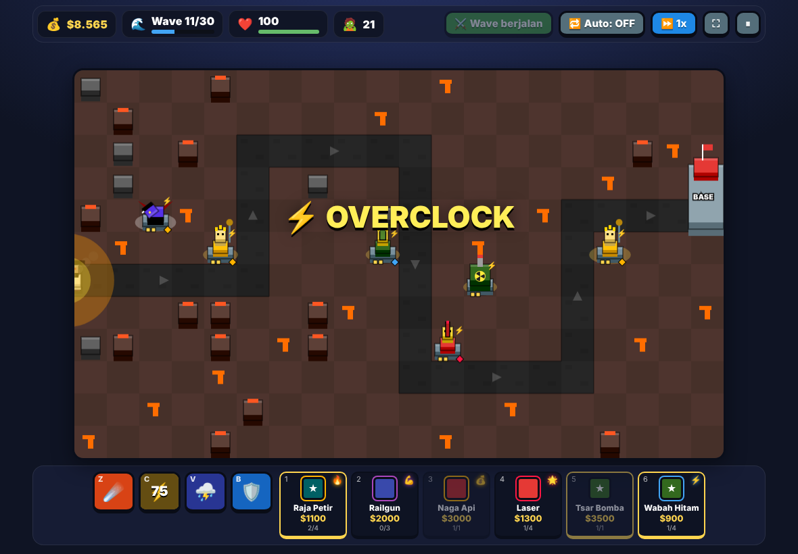
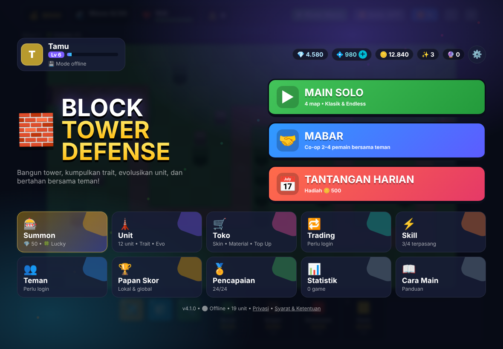
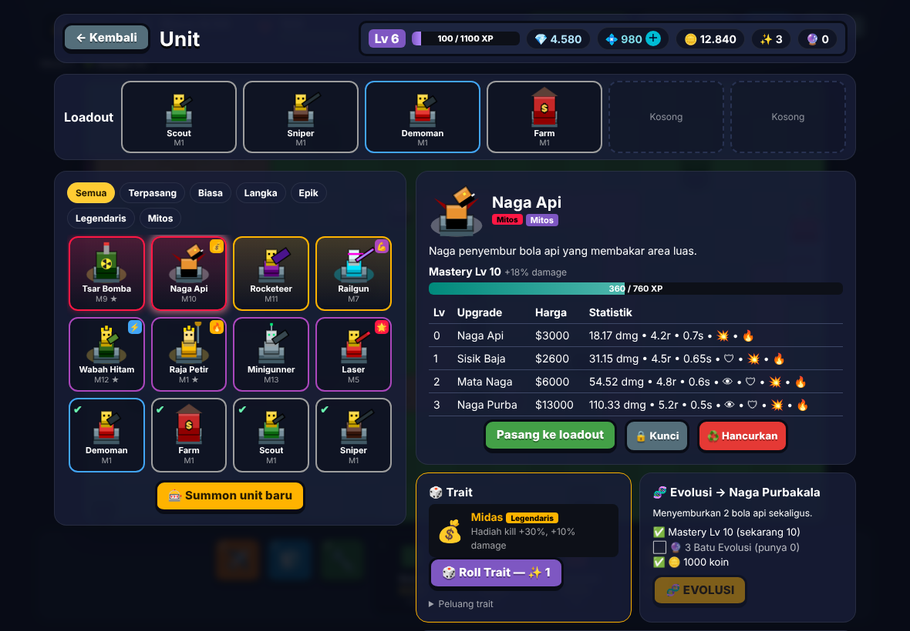

# 🧱 Block Tower Defense

Game **tower defense bergaya Roblox** (terinspirasi *Tower Defense Simulator*) yang berjalan langsung di browser.
Frontend HTML5 Canvas + JavaScript murni (tanpa build step). Fitur online memakai **Vercel** (serverless API) + **MongoDB Atlas** + **Login Google**.



## ▶️ Main Sekarang
- **Online (dengan mabar & login):** https://blocktowerdefense.vercel.app
- **Offline (GitHub Pages):** https://kingrafer.github.io/block-tower-defense/
- **Lokal:** clone repo ini lalu buka `index.html` di browser.

```bash
git clone https://github.com/KingRafer/block-tower-defense.git
cd block-tower-defense
# buka index.html, atau jalankan server lokal:
python3 -m http.server 8000   # lalu buka http://localhost:8000
```

## ✨ Fitur
| Kategori | Isi |
|---|---|
| 🎰 Gacha | Summon dengan **💎 Diamond** (gratis dari bermain): Banner Standar & Unggulan harian, pity 60. **🍀 Lucky Summon** dengan 💠 Permata (top up): peluang lebih tinggi, pity 30 |
| 🔁 Trading | Tukar unit (lengkap dengan trait/evolusi/mastery) dan 💎 Diamond dengan teman, divalidasi server |
| 💠 Top Up | Beli Permata lewat **Midtrans** (QRIS, e-wallet, transfer, kartu) untuk Lucky Summon & skin |
| 📱 HP | Responsif portrait/landscape, ketuk dua kali untuk memasang, layar penuh |
| 🎨 Skin | 9 skin kosmetik (Emas, Neon, Bayangan, Es, Lava, Santa, Ninja, Robot, Pelangi) |
| 🤝 Mabar | Co-op 2–4 pemain: lobby dengan kode room, chat, undang teman, koneksi P2P WebRTC + relay server |
| 👥 Teman | Tambah teman dengan kode, terima/tolak permintaan, status online, gabung ke room teman |
| 🔐 Akun Google | Login/daftar dengan Google, progres tersimpan di cloud (MongoDB) dan bisa dipakai di perangkat lain |
| 🌍 Skor global | Papan skor global: Klasik, Endless, Harian, Mabar |
| 🎲 Trait | 14 trait acak (Biasa → Langka → Epik → Legendaris → Mitos) yang diroll dengan 💎 Kristal |
| 🧬 Evolusi | Setiap tower bisa berevolusi menjadi bentuk baru dengan kemampuan unik |
| 📊 Mastery | Level tower 1–20 yang naik saat dipakai (+2% damage per level) |
| 🛒 Material | 💎 Kristal Trait & 🔮 Batu Evolusi dari hadiah game atau toko |
| 🎮 Mode | **Klasik**, **Endless** (wave tanpa batas), dan **Tantangan Harian** dengan modifier acak |
| ⚡ Skill pemain | 10 skill gratis tanpa batas (hanya cooldown), pasang 4 sekaligus |
| ⏭️ Skip wave | Mulai wave berikutnya lebih cepat dan dapat bonus uang |
| 💾 Simpan & lanjutkan | Progres tersimpan otomatis tiap akhir wave |
| 🏆 Papan skor | 15 skor terbaik dengan sistem poin |
| 💡 Tutorial | Tips muncul otomatis untuk pemain baru |
| 🗺️ Map | 4 map dengan tema berbeda: Padang Rumput, Gurun Pasir, Kutub Salju, Gunung Lava |
| ⚔️ Kesulitan | Mudah (20 wave), Normal (30 wave), Sulit (40 wave) |
| 🗼 Unit | 19 unit (Biasa → Mitos) dengan mekanik unik: petir berantai, laser, racun, railgun, aura waktu, nuklir, naga |
| 🧟 Musuh | 18 jenis musuh: terbang, pencuri, perisai, penyembuh, bunglon, nekromancer, mini-boss Golem, boss, dll |
| 👑 Boss | Muncul tiap 10 wave, bisa **stun** tower dan **memanggil pasukan** |
| 📈 Progres | Koin, XP, dan level pemain yang tersimpan antar sesi |
| 🛒 Toko & Loadout | Buka tower baru dengan koin, bawa maksimal 6 tower per game |
| 🏅 Pencapaian | 24 pencapaian dengan hadiah koin |
| 📊 Statistik | Statistik lengkap dan tabel rekor per map/kesulitan |
| 🔊 Audio | Efek suara dan musik latar yang dibuat langsung oleh browser (WebAudio) |
| ⚙️ Pengaturan | Volume, angka damage, getaran layar, grid, FPS, kualitas partikel, auto-pause |
| 📱 Responsif | Bisa dimainkan di desktop maupun HP (sentuh) |

<p align="center">
  
  
</p>

## 🗼 Unit (didapat dari Summon)
| Kelangkaan | Summon 💎 | Lucky 🍀 | Unit |
|---|---|---|---|
| Biasa | 55% | 25% | Scout, Sniper, Farm, Gunslinger |
| Langka | 30% | 37% | Demoman, Freezer, Meriam, Pembakar, Mortir |
| Epik | 11% | 27% | Minigunner, Commander, Tesla, Laser, Racun |
| Legendaris | 3,5% | 9% | Rocketeer, Railgun, Penjaga Waktu |
| Mitos | 0,5% | 2% | Nuklir, Naga Api |

Pemain baru mendapat Scout, Sniper, Demoman, Farm dan 300 💎. Setiap unit bisa diberi **trait**, **dievolusikan**, diberi **skin**, dikunci, dihancurkan untuk material, atau diperdagangkan.

## 🧟 Musuh
| Musuh | Ciri | Mulai |
|---|---|---|
| Zombie | Musuh dasar | Wave 1 |
| Pelari | Cepat, HP kecil | Wave 3 |
| Tank | Lambat, armor 25% | Wave 5 |
| Hantu | Tersembunyi, perlu deteksi hidden | Wave 7 |
| Penyembuh | Memulihkan HP terus-menerus | Wave 9 |
| Berzirah | Armor 50% | Wave 12 |
| Pemecah | Pecah menjadi 2 musuh kecil saat mati | Wave 14 |
| Kelelawar | Terbang — kebal Demoman, Meriam & Mortir | Wave 4 |
| Pencuri | Mencuri uang semua pemain jika lolos | Wave 6 |
| Kesatria Perisai | Perisai menyerap damage (tembus armor 2×) | Wave 8 |
| Pengamuk | 2× lebih cepat saat HP < 50% | Wave 10 |
| Dukun | Menyembuhkan musuh di sekitarnya | Wave 11 |
| Bunglon | Menghilang (hidden) berkala | Wave 13 |
| Peledak | Meledak & membuat tower pingsan saat mati | Wave 15 |
| Raksasa | HP sangat besar, pecah jadi 3 zombie | Wave 17 |
| Nekromancer | Terus memanggil kerangka | Wave 19 |
| Golem Batu (mini-boss) | Armor 40%, kebal efek lambat | Wave 15, 25, 35… |
| Raja Zombie (boss) | Stun tower & memanggil pasukan | Tiap 10 wave |

## ⌨️ Kontrol
| Tombol | Aksi |
|---|---|
| `1`–`6` | Pilih tower dari loadout |
| Klik | Pasang / pilih tower |
| `Shift` + klik | Pasang tower berulang |
| `Q` / `E` | Upgrade tower terpilih |
| `X` / `Del` | Jual tower terpilih (kembali 60%) |
| `T` | Ganti mode target (Pertama/Terakhir/Terkuat/Terdekat) |
| `Spasi` | Mulai / skip wave |
| `Z` `C` `V` `B` | 4 skill yang terpasang |
| `F` | Ganti kecepatan 1x/2x/3x |
| `Esc` / klik kanan | Batal / pause |
| 📱 Ketuk 2× | Di HP: ketuk sekali untuk pratinjau, ketuk lagi di tempat yang sama untuk memasang tower / skill |

## 🎲 Trait
| Kelangkaan | Peluang | Contoh |
|---|---|---|
| Biasa | 60% | Kuat I (+5% dmg), Cepat I (−5% cooldown), Jangkauan I |
| Langka | 25% | Kuat II, Cepat II, Jangkauan II, Hemat (−15% harga) |
| Epik | 11% | Kuat III, Mata Elang (hidden), Penembus (tembus armor), Pemburu Raja |
| Legendaris | 3,5% | Midas (+30% hadiah kill), Berserker (+25% dmg, −15% cooldown) |
| Mitos | 0,5% | Dewa Perang (+40% dmg, −20% cooldown, +15% range, hidden) |

## 🧬 Evolusi
Syarat: **Mastery Lv 10 + 🔮 3 Batu Evolusi + 🪙 1.000**. Tower yang sudah berevolusi otomatis dipakai dalam bentuk barunya.

| Tower | Evolusi | Kemampuan unik |
|---|---|---|
| Scout | Ranger | Setiap tembakan ke-4 memberi damage 3× |
| Sniper | Deadeye | 25% peluang critical 3× |
| Demoman | Bombardier | Ledakan membakar musuh |
| Freezer | Cryomancer | 20% peluang membekukan musuh |
| Farm | Bank | Pendapatan +50% + bunga 2% |
| Minigunner | Gatling Titan | Damage naik hingga +80% saat terus menembak |
| Commander | Panglima | Buff +10% & range +20% |
| Rocketeer | Warlord | Menembak 2 misil sekaligus |

## ⚡ Skill Pemain
10 skill gratis tanpa batas pemakaian (hanya cooldown). Pasang hingga 4 skill (tombol `Z` `C` `V` `B`): Serangan Udara, Badai Es, Perbaikan Base, Dana Darurat, Radar, Overclock, Perisai Base, Meteor, Putar Waktu, Badai Petir.

## 📅 Tantangan Harian
Setiap hari map, kesulitan, dan 2 modifier dipilih secara acak (sama untuk semua pemain di hari yang sama). Contoh modifier: *Musuh Gesit*, *Kulit Baja*, *Tanpa Farm*, *Base Rapuh*, *Malam Berkabut*. Selesaikan 20 wave untuk mendapat 🪙 500.

## 🗂️ Struktur Proyek
```
block-tower-defense/
├── index.html          # Halaman utama & layout HUD
├── api/                # Backend Vercel (satu fungsi: /api?r=...)
│   ├── index.js        # Rute: auth, profil, ekonomi, trading, top up, teman, room, relay, papan skor
│   └── _lib/           # MongoDB, autentikasi, ekonomi (vault, trading, Midtrans)
├── test/               # Uji API dengan MongoDB palsu
├── dev-server.js       # Server lokal (statis + /api)
├── css/style.css       # Semua styling (tema, menu, responsif)
├── js/
│   ├── shared.js       # Logika ekonomi bersama browser & server (gacha, trait, toko, hadiah)
│   ├── config.js       # Data: map, unit, musuh, kesulitan, mode, skill, modifier, pencapaian
│   ├── storage.js      # Simpan/muat pengaturan, profil & game berjalan (localStorage)
│   ├── audio.js        # Efek suara & musik prosedural (WebAudio)
│   ├── game.js         # Logika inti: wave, tower, musuh, boss, skill, harian, skor
│   ├── render.js       # Menggambar peta, unit, dan efek ke canvas
│   ├── ui.js           # HUD, hotbar, panel tower, tooltip, toast
│   ├── menu.js         # Semua layar menu
│   ├── online.js       # Akun Google, cloud save, teman, lobby, jaringan & sinkronisasi mabar
│   └── main.js         # Input, game loop, inisialisasi
├── docs/               # Screenshot
└── .github/workflows/  # Deploy otomatis ke GitHub Pages
```

### Menambah konten
- **Tower baru:** tambahkan entri di `TOWERS` dan `TOWER_ORDER` (`js/config.js`), lalu atur bentuk senjatanya di `drawTower` (`js/render.js`).
- **Musuh baru:** tambahkan di `ENEMIES` dan `ENEMY_INTRO`, lalu masukkan ke `buildWave` (`js/game.js`).
- **Map baru:** tambahkan di `MAPS`. Jalur ditulis sebagai titik-titik grid (20×12); titik pertama di kolom `-1` dan titik terakhir di kolom `21`.

## 🌐 Fitur Online
Panduan lengkap: **[docs/SETUP-ONLINE.md](docs/SETUP-ONLINE.md)** (env Vercel, Google Client ID, struktur database, uji lokal).

## 🚀 Deploy
**Vercel (disarankan, fitur online aktif):** import repo ini di Vercel, isi environment variable (`MONGODB_URI`, `SESSION_SECRET`, `GOOGLE_CLIENT_ID`), lalu deploy. Detail di [docs/SETUP-ONLINE.md](docs/SETUP-ONLINE.md).

**GitHub Pages (offline saja):** workflow `.github/workflows/pages.yml` tetap tersedia; fitur online otomatis nonaktif di sana.

## 📄 Lisensi
[MIT](LICENSE) © KingRafer
